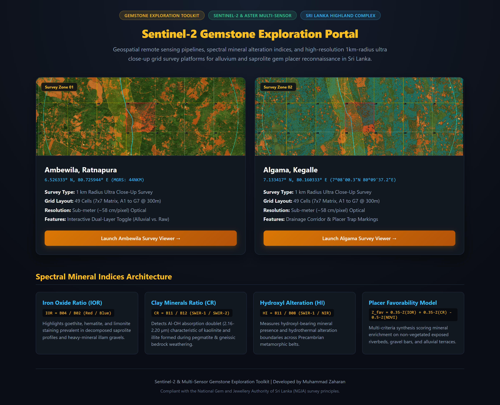
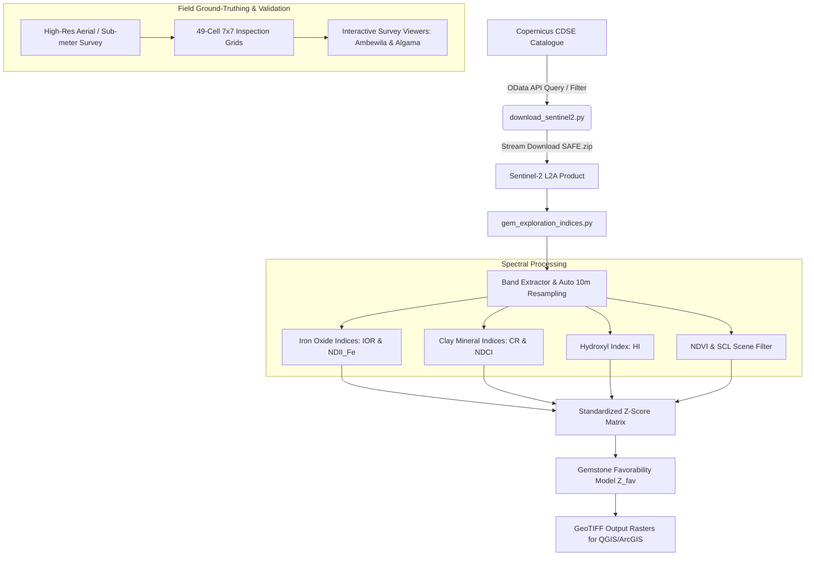
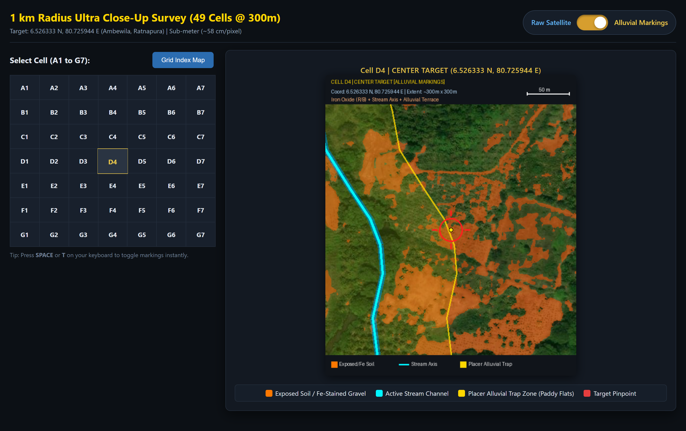
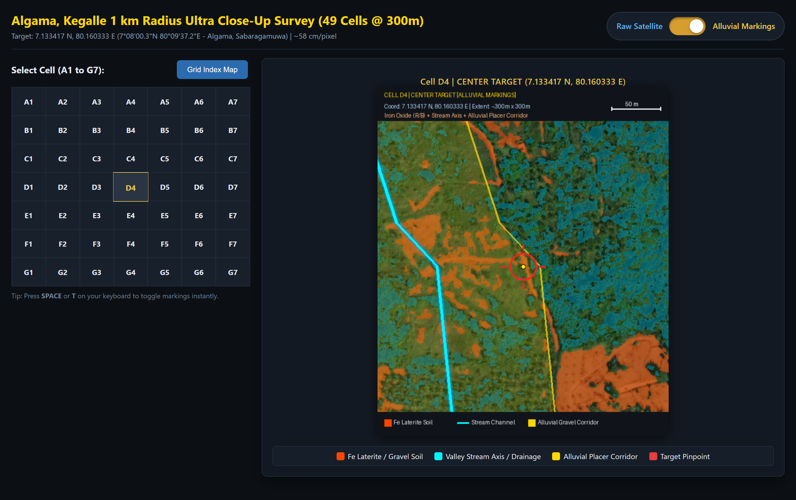
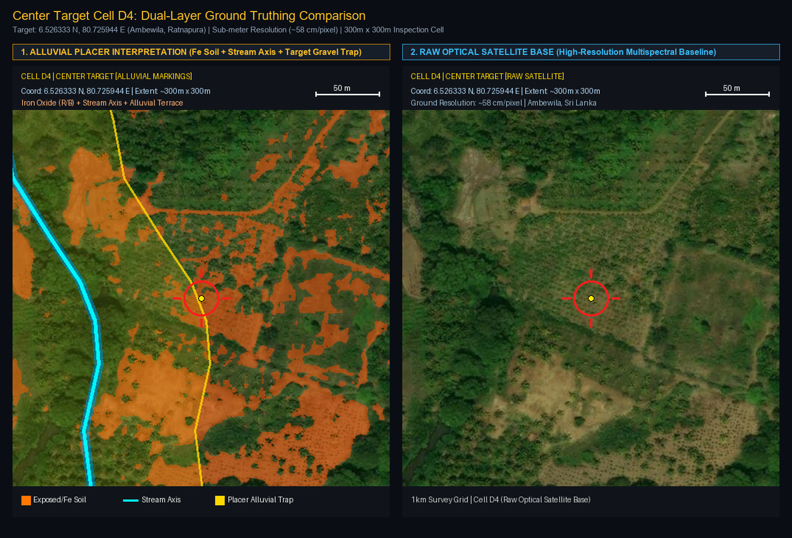
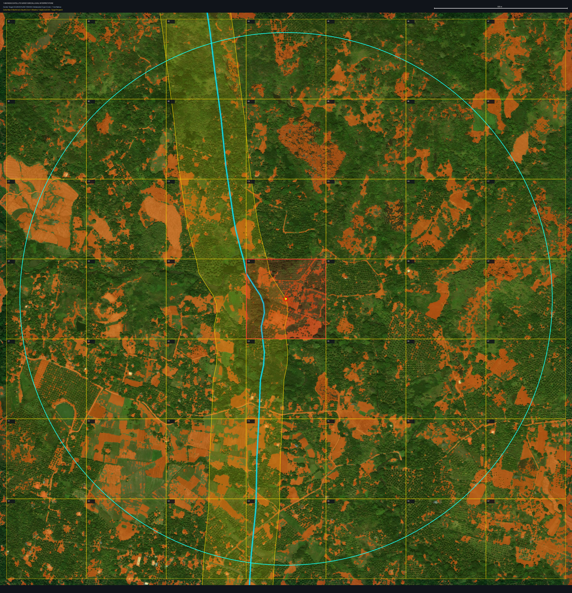
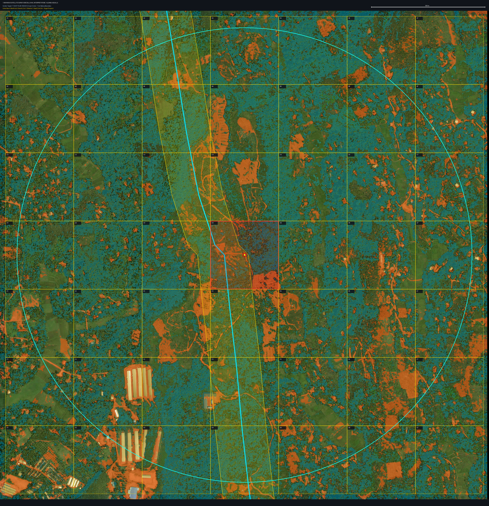

# Sentinel-2 & Multi-Sensor Gemstone Exploration Toolkit

[](https://www.python.org/)
[](https://dataspace.copernicus.eu/)
[](https://rasterio.readthedocs.io/)
[](LICENSE)
[](#high-resolution-survey-viewers)

> **Automated satellite remote sensing pipelines, spectral mineral ratio modeling, and high-resolution exploration grid survey suites tailored for secondary alluvial placer ("Illam") and saprolite gemstone reconnaissance across Sri Lanka's Highland Complex.**

---

## Table of Contents
1. [Overview](#overview)
2. [Geological Background & Illam Gravels](#geological-background--illam-gravels)
3. [System Architecture](#system-architecture)
4. [Spectral Mineral Indices](#spectral-mineral-indices)
5. [Multi-Criteria Gemstone Favorability Model](#multi-criteria-gemstone-favorability-model)
6. [Copernicus CDSE Downloader](#copernicus-cdse-downloader)
7. [High-Resolution Survey Viewers](#high-resolution-survey-viewers)
8. [Installation & Setup](#installation--setup)
9. [CLI Quickstart Guide](#cli-quickstart-guide)
10. [QGIS & GIS Integration](#qgis--gis-integration)
11. [Repository Layout](#repository-layout)
12. [Compliance & Environmental Notice](#compliance--environmental-notice)
13. [License & Credits](#license--credits)

---

## Overview

Over 90% of Sri Lanka's landmass comprises high-grade Precambrian metamorphic crystalline basement (the **Highland**, **Vijayan**, and **Wanni** Complexes). Weathering and fluvial transport of primary corundum-bearing gneisses and pegmatites have concentrated world-class gem gravels (**Illam**) into valleys, river bends, and paleochannels.

This toolkit provides an end-to-end remote sensing solution for gemological exploration:
- **Copernicus CDSE Ingestion**: Automated querying, cloud-filtering, and downloading of Sentinel-2 Level-2A surface reflectance data.
- **Spectral Mineral Processing**: 10m-resolution calculation of Iron Oxide Ratios (IOR, NDII_Fe), Clay Mineral Ratios (CR, NDCI), and Hydroxyl Alteration (HI).
- **Gem Placer Favorability Model**: Multi-criteria weighted $Z$-score synthesis with automated vegetation and cloud masking.
- **Interactive High-Resolution Survey Suites**: 49-cell, 1km-radius sub-meter survey inspection viewers with dual-layer toggleable alluvial markings for **Ambewila (Ratnapura)** and **Algama (Kegalle)**.

<p align="center">
  <a href="docs/screenshots/portal_hub.png">
    
  </a>
  <br>
  <em>Interactive Central Exploration Portal (<a href="index.html">index.html</a>) featuring direct launch gateways for Ambewila and Algama survey platforms, alongside spectral alteration formulations.</em>
</p>

---

## Geological Background & Illam Gravels

```
[ Primary Source: Granulite / Pegmatite ]
                  │
                  ▼ Tropical Lateritization & Saprolitization
[ Decomposed Bedrock with Iron Oxides (Goethite / Hematite) & Clays (Kaolinite) ]
                  │
                  ▼ Fluvial Erosion & Transport down Drainage Axes
[ Alluvial Valley Placer: "Illam" Heavy Mineral Gravel Layer (Hardness 8-9 Gems) ]
                  │
                  ▼ Overburden Deposition (Silt, Clay, Sand)
[ Modern Surface: Identified by Spectral Mineral Ratios & Bare Soil Anomalies ]
```

- **Heavy Mineral Accumulation**: Corundum (hardness 9, specific gravity ~4.0) and chrysoberyl (hardness 8.5, specific gravity ~3.7) resist weathering and settle at the base of alluvial gravels.
- **Surface Spectral Trace**: Saprolitic soils and exposed river gravels exhibit heavy **ferric iron oxide staining** and **aluminosilicate clay alteration**, which produce sharp absorption features detectable in Sentinel-2 MSI and ASTER SWIR channels.

---

## System Architecture



---

## Spectral Mineral Indices

| Index | Formula | Sentinel-2 Bands | Exploration Significance |
| :--- | :--- | :--- | :--- |
| **Iron Oxide Ratio (IOR)** | $\frac{\text{B04}}{\text{B02}}$ | Red / Blue | Maps limonite, goethite, and hematite staining in decomposed saprolite. |
| **NDII_Fe** | $\frac{\text{B04} - \text{B02}}{\text{B04} + \text{B02}}$ | (Red - Blue) / (Red + Blue) | Normalized index quantifying ferric iron concentration. |
| **Clay Minerals Ratio (CR)** | $\frac{\text{B11}}{\text{B12}}$ | SWIR-1 / SWIR-2 | Detects $Al\text{-}OH$ absorption at $2.20\,\mu\mathrm{m}$ from kaolinite and illite. |
| **NDCI** | $\frac{\text{B11} - \text{B12}}{\text{B11} + \text{B12}}$ | (SWIR-1 - SWIR-2) / Sum | Normalized index highlighting clay alterational pockets and gravel traps. |
| **Hydroxyl Index (HI)** | $\frac{\text{B11}}{\text{B08}}$ | SWIR-1 / NIR | Broad phyllosilicate and hydroxyl mineral indicator. |
| **NDVI** | $\frac{\text{B08} - \text{B04}}{\text{B08} + \text{B04}}$ | (NIR - Red) / Sum | Screens dense vegetation canopy ($\le 0.30$ isolates bare ground). |

---

## Multi-Criteria Gemstone Favorability Model

To provide a single, quantitative prospecting layer, each spectral index is normalized to zero-mean unit-variance ($Z$-score) across valid ground pixels:

$$Z(X) = \frac{X - \mu_X}{\sigma_X}$$

The integrated Gem Favorability Score is formulated as:

$$Z_{fav} = 0.35 \cdot Z(\mathrm{IOR}) + 0.15 \cdot Z(\mathrm{NDII_{Fe}}) + 0.35 \cdot Z(\mathrm{CR}) + 0.15 \cdot Z(\mathrm{NDCI}) - 0.50 \cdot Z(\mathrm{NDVI})$$

Two primary rasters are exported:
1. `favorability_S2.tif`: Masked strictly to exposed soils, riverbeds, and low-canopy zones ($\mathrm{NDVI} \le 0.30$ and cloud/water-free).
2. `favorability_unmasked_S2.tif`: Continuous regional favorability surface showing broad geological trends.

---

## Copernicus CDSE Downloader

`download_sentinel2.py` interfaces with the Copernicus Data Space Ecosystem via OpenID Connect (Keycloak) and OData APIs.

### Pre-Configured Sri Lanka Gem Localities:
| Location Name | MGRS Tile | District | Focus Mineralization |
| :--- | :--- | :--- | :--- |
| `ratnapura`, `kuruwita`, `pelmadulla`, `nivithigala` | `44NKM` | Ratnapura | Corundum (Blue Sapphire, Ruby, Padparadscha) |
| `balangoda`, `bogawantalawa` | `44NLM` | Ratnapura / Nuwara Eliya | Geuda sapphire, zircon, spinel |
| `elahera`, `bakamuna` | `44NMM` | Matale / Polonnaruwa | Chrysoberyl (Cat's Eye, Alexandrite), tourmaline |
| `okkampitiya`, `kataragama` | `44NMK` | Monaragala | Alluvial sapphire, star corundum, garnet |

See [docs/SRI_LANKA_TILES.md](docs/SRI_LANKA_TILES.md) for full coordinates and metadata.

---

## High-Resolution Survey Viewers

The project includes two interactive, standalone web survey applications built with HTML5, CSS3, and JavaScript for micro-scale target verification, accessible through a master portal.

### Master Portal
Launch [`index.html`](index.html) in any modern browser to access the central exploration hub.

---

### Survey Zone 1: Ambewila, Ratnapura
- **Coordinates**: `6.526333° N, 80.725944° E` (Center Target Cell D4)
- **District**: Ratnapura (Alluvial corundum, blue sapphire, ruby, padparadscha)
- **Grid Layout**: 49 cells (7x7 matrix, A1 to G7, 300m x 300m per cell)
- **Resolution**: Sub-meter (~58 cm/pixel) optical baseline
- **Interactive Viewer**: [`sentinel-2 6.526333 N, 80.725944 E (Ambewila, Ratnapura/index.html`](sentinel-2%206.526333%20N,%2080.725944%20E%20%28Ambewila,%20Ratnapura/index.html)

<p align="center">
  <a href="docs/screenshots/ambewila_survey_viewer.png">
    
  </a>
  <br>
  <em>Ambewila Survey Viewer: 49-cell matrix inspection with Center Target Cell D4 highlighted, active stream channel vectors, and iron-oxide lateritic gravel markings.</em>
</p>

---

### Survey Zone 2: Algama, Kegalle
- **Coordinates**: `7.133417° N, 80.160333° E` (Center Target Cell D4)
- **District**: Kegalle / Sabaragamuwa border (Stream gravel placers & saprolitic terrace deposits)
- **Grid Layout**: 49 cells (7x7 matrix, A1 to G7, 300m x 300m per cell)
- **Resolution**: Sub-meter (~58 cm/pixel) optical baseline
- **Interactive Viewer**: [`ultra_closeup_1km_algama/index.html`](ultra_closeup_1km_algama/index.html)

<p align="center">
  <a href="docs/screenshots/algama_survey_viewer.png">
    
  </a>
  <br>
  <em>Algama Survey Viewer: Center Target Cell D4 selected showing drainage axis confluence and prospective placer alluvial trap corridors.</em>
</p>

---

### Dual-Layer Ground-Truthing Comparison

Each survey cell incorporates instant dual-layer ground-truthing to compare automated geological interpretation directly against raw optical satellite captures:

<p align="center">
  <a href="docs/screenshots/cell_d4_comparison.png">
    
  </a>
  <br>
  <em>Target Cell D4 Ground-Truthing: (Left) Alluvial Placer Interpretation showing iron-oxide gravels, stream axis, and alluvial trap corridors; (Right) Raw Optical Satellite Imagery (~58 cm/pixel).</em>
</p>

---

### 1 km Radius Master Grid Survey Maps (49-Cell Grids)

| Survey Zone 01: Ambewila, Ratnapura (`6.526333° N, 80.725944° E`) | Survey Zone 02: Algama, Kegalle (`7.133417° N, 80.160333° E`) |
| :---: | :---: |
| <a href="docs/screenshots/ambewila_grid_map.png"></a> | <a href="docs/screenshots/algama_grid_map.png"></a> |
| *Ambewila 7x7 Exploration Grid & Alluvial Overlay* | *Algama 7x7 Exploration Grid & Alluvial Overlay* |

---

### Interactive Viewer Capabilities:
- **Instant Dual-Layer Switch**: Toggle between **Alluvial Markings** (drainage corridors, gravel soils, placer axes) and **Raw Satellite Imagery**.
- **Keyboard Shortcuts**: Press `SPACE` or `T` to toggle layers; click any grid cell (A1–G7) for instant inspection.
- **Distance & Bearing Vectors**: Displays exact distance (meters) and bearing relative to the central target.

---

## Installation & Setup

### Requirements:
- Python 3.9+
- GDAL and Rasterio (recommended via Conda or pip)

### Option A: Using Conda (Recommended for GIS/GDAL)
```bash
conda env create -f environment.yml
conda activate gem-exploration
```

### Option B: Using Pip
```bash
pip install -r requirements.txt
```

---

## CLI Quickstart Guide

### 1. Search for Clear Scenes
```bash
# Search scenes with <= 10% clouds over Ratnapura (MGRS 44NKM)
python download_sentinel2.py search --location ratnapura --max-cloud 10

# Search with date filters
python download_sentinel2.py search --location elahera --start 2026-01-01 --end 2026-03-31
```

### 2. Download and Auto-Process
```bash
# Stream download scene by product UUID and generate GeoTIFF rasters
python download_sentinel2.py download \
  --id "<COPERNICUS_PRODUCT_UUID>" \
  --dest "./downloads" \
  --process \
  --output-indices "./indices_ratnapura"
```

### 3. Process an Existing `.SAFE` or `.zip` Archive
```bash
# Process Sentinel-2 product
python gem_exploration_indices.py ./downloads/S2A_MSIL2A_...SAFE.zip --output ./output_S2

# Process ASTER multispectral bands
python gem_exploration_indices.py ./aster_bands/ --output ./output_AST --sensor aster
```

See [docs/CLI_REFERENCE.md](docs/CLI_REFERENCE.md) for full argument references.

---

## QGIS & GIS Integration

All exported rasters are georeferenced GeoTIFFs formatted in the acquisition's native UTM projection (e.g., **WGS 84 / UTM zone 44N, EPSG:32644**).

1. Load `favorability_S2.tif` into QGIS.
2. Select **Singleband pseudocolor** with an inverted **Spectral** or **Turbo** color ramp.
3. Stretch from **Min: -1.0** to **Max: +3.5** ($Z$-score standard deviations).
4. Overlay `bare_mask.tif` with cyan fill at 40% opacity to highlight prospective gravel placers.

Detailed instructions are available in [docs/QGIS_GUIDE.md](docs/QGIS_GUIDE.md).

---

## Repository Layout

```
sentinel-2/
├── index.html                           # Root geospatial survey launch portal
├── download_sentinel2.py                # Copernicus CDSE search & download client
├── gem_exploration_indices.py           # Multi-sensor mineral indices & favorability engine
├── requirements.txt                     # Pip dependency specification
├── environment.yml                      # Conda / Mamba geospatial environment
├── LICENSE                              # MIT License
├── README.md                            # Primary documentation manual
│
├── docs/                                # Technical & Scientific Documentation
│   ├── METHODOLOGY.md                   # Geological background, physics & formulas
│   ├── CLI_REFERENCE.md                 # Complete CLI argument manual
│   ├── QGIS_GUIDE.md                    # GIS visualization & layer styling guide
│   ├── SRI_LANKA_TILES.md               # Sri Lanka gem districts & MGRS tile lookup
│   └── screenshots/                     # High-resolution documentation screenshots & figures
│       ├── portal_hub.png               # Master portal interface overview
│       ├── ambewila_survey_viewer.png   # Ambewila interactive 49-cell viewer
│       ├── algama_survey_viewer.png     # Algama interactive 49-cell viewer
│       ├── cell_d4_comparison.png       # Dual-layer ground-truthing comparison (D4)
│       ├── ambewila_grid_map.png        # Ambewila 1km grid survey map
│       └── algama_grid_map.png          # Algama 1km grid survey map
│
├── sentinel-2 6.526333 N, 80.725944 E (Ambewila, Ratnapura)/
│   ├── index.html                       # Ambewila interactive 49-cell viewer
│   ├── 00_GRID_INDEX_MAP.png            # Master 7x7 index grid overview
│   ├── 00_GRID_INDEX_ALLUVIAL.png       # Alluvial interpretation overview
│   ├── 00_GRID_INDEX_RAW.png            # Raw optical overview
│   └── Cell_*.png                       # 49 individual cell pairs (raw & alluvial)
│
└── ultra_closeup_1km_algama/
    ├── index.html                       # Algama interactive 49-cell viewer
    ├── 00_GRID_INDEX_MAP.png            # Master 7x7 index grid overview
    ├── 00_GRID_INDEX_ALLUVIAL.png       # Alluvial interpretation overview
    ├── 00_GRID_INDEX_RAW.png            # Raw optical overview
    └── Cell_*.png                       # 49 individual cell pairs (raw & alluvial)
```

---

## Compliance & Environmental Notice

> [!IMPORTANT]
> All gemstone prospecting, mining, and exploration activities in Sri Lanka are strictly regulated by the **National Gem and Jewellery Authority (NGJA)** under the *National Gem and Jewellery Authority Act No. 50 of 1993*.
>
> Satellite remote sensing and spectral modeling provide non-invasive preliminary indicators. Ground reconnaissance, pit sinking, and mechanized mining require formal licenses, environmental impact assessments (EIA), and adherence to sustainable reclamation regulations.

---

## License & Credits

- **Author**: Muhammad Zaharan ([@muhzahjr07](https://github.com/muhzahjr07))
- **License**: [MIT License](LICENSE)
- **Data Acknowledgement**: Contains modified Copernicus Sentinel data (2026) processed via Copernicus Data Space Ecosystem.
